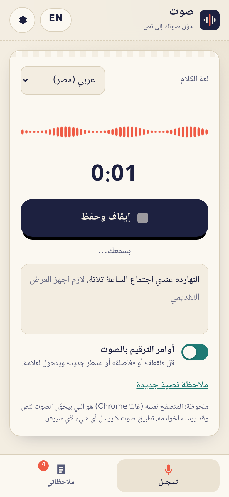
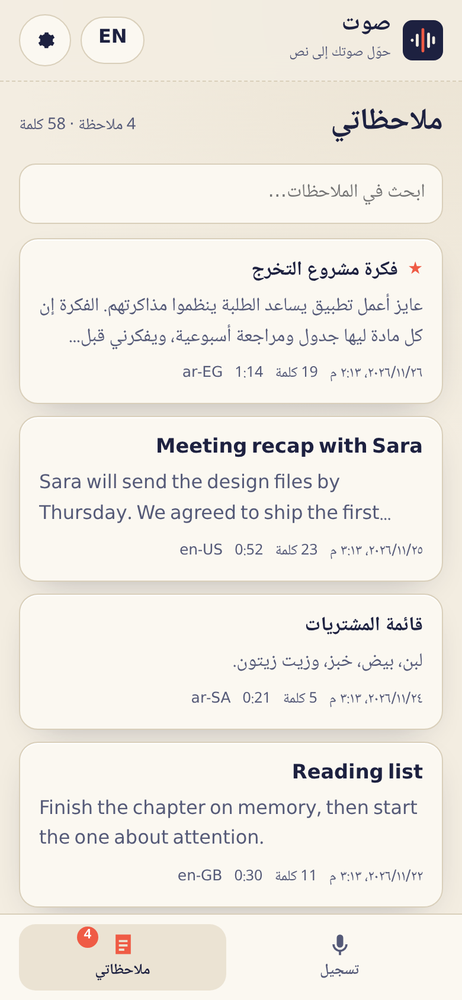
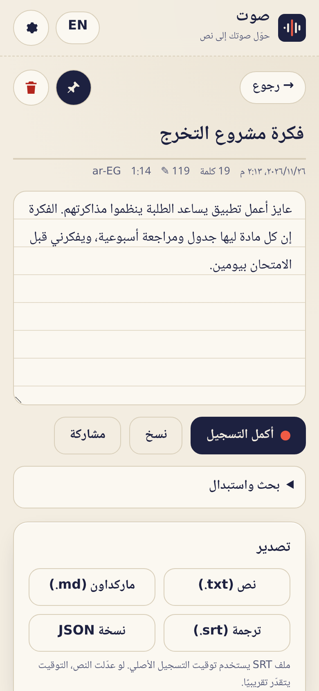
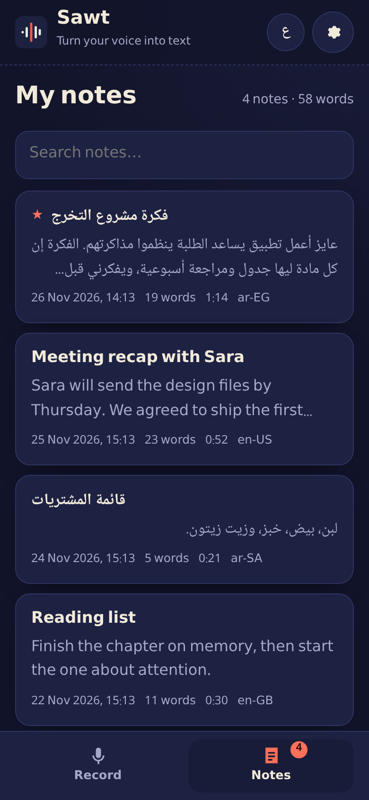

<p align="center"></p>

<h1 align="center">Sawt · صوت</h1>

<p align="center"><b>Talk. Get text. Edit it. Take it with you.</b><br>
Voice notes to editable text in Arabic and English, right in your browser.<br>
No account, no server, no build step.</p>

<p align="center"><a href="https://yousefkhames.github.io/sawt/"><b>Open the live demo →</b></a></p>

<p align="center">




</p>

## What it does

- **Live transcription** while you speak, with grey interim text that turns solid as each phrase is confirmed.
- **Four speech languages**: Arabic (Egypt), Arabic (Saudi), English (US), English (UK).
- **Spoken punctuation**: say "نقطة", "فاصلة", "علامة استفهام", "سطر جديد", or "period", "comma", "question mark", "new line" and get the mark instead of the word. Can be turned off.
- **Auto restart** on silence, so a long note does not stop by itself when the browser's recognizer times out.
- **Keep recording**: add more speech to the end of an existing note.
- **Real editor**: ruled-paper text area, title, word and character count, find and replace (case-insensitive), pin, delete with undo.
- **Export** one note as `.txt`, `.md`, `.srt` subtitles (using the recorded timing) or JSON. Back up and restore everything as one JSON file.
- **Search** across titles and text with highlighting.
- **Arabic and English interface** with full RTL layout, light, dark and auto themes, mobile-first, keyboard and screen reader friendly.
- **Type-only fallback**: in a browser without speech recognition you still get notes, editing and export.

## Tech

Plain HTML, CSS and JavaScript. No framework, no dependencies, no build.
Speech comes from the browser's Web Speech API (`SpeechRecognition` / `webkitSpeechRecognition`). The waveform uses `getUserMedia` and an `AnalyserNode`. Notes live in `localStorage`.

```
index.html       app shell
css/style.css    design (paper-tape look, RTL aware, dark theme)
js/lib.js        pure logic: punctuation, SRT/MD/TXT, import, search (unit tested)
js/i18n.js       Arabic and English strings
js/app.js        UI, recognizer control, storage
tests/           unit tests and a real-Chrome click-through
```

## Run it

```bash
python3 -m http.server 8123   # or any static server
# open http://localhost:8123
```

Speech recognition needs `https://` or `localhost`.

## Tests

```bash
node --test tests/unit.test.js        # 17 unit tests
node tests/e2e.js http://127.0.0.1:8123/   # 38 checks in real Chrome (needs Chrome installed)
node tests/e2e.js https://yousefkhames.github.io/sawt/   # same checks on the live site
```

The click-through drives real Chrome over the DevTools protocol: recording, editing, find and replace, append, all four exports, pin, search, delete and undo, import, theme, wipe, permission-denied, and an unsupported-browser run. **Headless Chrome has no microphone or speech service, so the recognizer is replaced by a scripted fake** that fires the same events. The app code around it is real. Actual transcription quality was not measured by these tests.

## Honest limits

- **Browser support.** Works in Chrome, Edge and Safari (Safari with limits). Firefox has no `SpeechRecognition`; Sawt shows a notice and falls back to typing.
- **Not offline, not private by itself.** In Chrome, the browser sends your audio to Google's speech service. Sawt itself sends nothing anywhere, but the browser does. Do not use it for secrets.
- **Accuracy is the browser's.** Egyptian Arabic dialect, names and mixed Arabic-English speech can come out wrong. That is why every note is editable.
- **Spoken punctuation is rule-based.** The word "comma" always becomes a comma while the option is on.
- **SRT timing.** Exact for recorded segments. After you edit the text, timing is estimated from sentence length.
- **Data is per browser.** Notes are in `localStorage` on one device and browser. Clearing site data, private mode, or another device means they are gone. Export a backup.
- **Demo hosting.** GitHub Pages is a demo host. No audio files are saved, only text.
- Mobile browsers can pause recognition when the screen locks or the tab is in the background.

## License

MIT, see [LICENSE](LICENSE).
